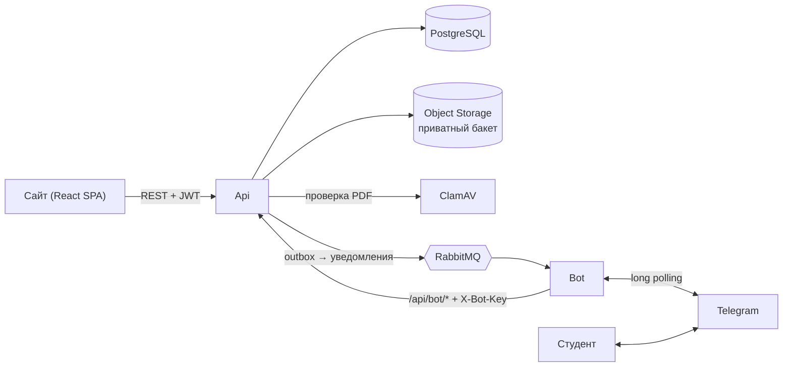

# ФИИТ ДЗ — обзор

## Концепция

Сервис сдачи и проверки домашних заданий для ФИИТ.

- **Преподаватель работает на сайте.** Заводит курсы и приглашает студентов, выдаёт задания с дедлайнами, проверяет работы пометками прямо на PDF и ставит баллы. Ведёт сводную таблицу и выгружает её в Excel.
- **Студент работает только в Telegram-боте.** Записывается по ссылке-приглашению, получает задания, сдаёт PDF и получает оценку, комментарий и PDF с пометками.

Полный цикл:

1. Преподаватель создаёт курс и ссылку-приглашение.
2. Студент проходит анкету в боте, преподаватель подтверждает заявку.
3. Преподаватель публикует ДЗ, и студенту приходит уведомление.
4. Студент присылает PDF.
5. Преподаватель проверяет работу на сайте и отправляет результат, он приходит студенту в Telegram.

Подробные требования — [docs/tz.md](docs/tz.md), решения и API — [docs/architecture.md](docs/architecture.md), запуск — [README.md](README.md).

## Архитектура

| Компонент | Роль | Технологии |
|---|---|---|
| **Web** | сайт преподавателя по дизайну FIITProject/frontend (`fiit-design`) | React 19, TypeScript, Vite, react-router, pdf.js; nginx раздаёт статику и проксирует `/api` |
| **Api** | вся бизнес-логика и права; единственный владелец БД и файлов; публикует уведомления | ASP.NET Core (.NET 10), EF Core + Npgsql, PDFsharp, ClosedXML, AWSSDK.S3, RabbitMQ.Client |
| **migrate** | применяет миграции БД перед запуском новой версии API и выходит | тот же образ, `dotnet Fiit.Api.dll migrate` |
| **Bot** | разговор со студентами в Telegram и доставка уведомлений | .NET Worker, Telegram.Bot 22 |
| **PostgreSQL** | данные, outbox уведомлений | EF Core, миграции, snake_case |
| **Object Storage** | сданные PDF и PDF с пометками | Yandex Object Storage, локально RustFS |
| **RabbitMQ** | очередь уведомлений от API к боту, повторы, dead-очередь | RabbitMQ 4.1 |
| **ClamAV** | антивирусная проверка сдаваемых PDF | clamd по TCP |

Общий код:
- `Fiit.Contracts` — DTO и enum-ы API. Общие для api, бота и эмулятора; на сайте — TypeScript-зеркало `web/app/src/api/types.ts`;
- `Fiit.Messaging` — очереди RabbitMQ и формат сообщения, общие для api и бота;
- `Fiit.Bot.Core` — диалог бота без привязки к Telegram. Его же использует эмулятор бота на старом тестовом сайте.

### Принципы

- **Бэкенд — единственный владелец данных.** Сайт и бот ходят только в API, у бота нет своей БД. Права проверяются на сервере на каждом эндпоинте, а не на фронте.
- **Уведомление не теряется и не появляется без события.**
  - Transactional outbox: строка уведомления пишется в той же транзакции, что и событие.
  - Публикация в RabbitMQ идёт с подтверждением брокера.
  - Перед отправкой бот сверяет статус уведомления в API, поэтому повторная доставка не шлёт сообщение дважды.
- **Файлы только через API.** Бакет приватный: файл отдаётся после проверки прав, presigned-ссылок нет. Сдаваемый PDF проверяется до сохранения, и если проверить не удалось, файл не принимается.
- **Миграции — отдельный шаг деплоя.** API со схемой старее своего кода не стартует. Миграция должна быть совместима со старой версией кода, которая ещё работает.
- **Сайт повторяет дизайн один в один.** CSS дизайна взят без изменений, каждая страница сверена с оригинальным HTML. Функции из ТЗ, которым в дизайне нет отдельного места, встроены в его элементы.
- **Время хранится в UTC, показывается по Екатеринбургу** (UTC+5, без перехода на летнее время).

## Что умеет приложение и как это сделано

### Вход и преподаватели

**Что:**
- вход по логину и паролю, сессия на 14 дней;
- нового преподавателя заводит коллега: аккаунт с временным паролем, который при первом входе нужно сменить;
- коллеге можно сбросить пароль, а отключить его может тот, кто его добавил;
- первый преподаватель создаётся командой `add-teacher`.

**Как:**
- **Токен.** API выдаёт JWT. На каждом запросе проверяется, что преподаватель активен и токен выпущен не раньше `teachers.sessions_valid_from`. Эта отметка сдвигается при смене и сбросе пароля и при отключении, поэтому старые сессии сразу перестают работать.
- **Временный пароль.** С ним доступны только `/api/me` и смена пароля, а сайт сам переводит на страницу смены.
- **Пароли** хранятся как bcrypt-хеши.
- **На сайте** коллега добавляется на вкладке курса «Преподаватели»: если логина ещё нет, сайт предлагает создать аккаунт. Сброс пароля и отключение — по клику на имя.

### Курсы, группы и архив

**Что:** курс — это предмет × подгруппа × семестр, например «Тервер, ФТ-201-1, осень 2026». У курса есть ведущий преподаватель, он выдаёт доступ коллегам. Курс отправляется в архив по окончании семестра.

**Как:**
- **Архив.** Архивный курс доступен только для чтения: изменяющие запросы получают 409 `course_archived`. Ожидающие заявки отклоняются с причиной «Набор закрыт», приглашения закрываются.
- **На сайте** «курс», как в дизайне, — предмет в семестре со всеми подгруппами (маршрут `/c/:subjectId/:semester`). Вкладки: задания, сводная, студенты, приглашения, преподаватели, настройки.
- **Группы** вводятся строкой вида «ФТ-201-1» или «фт 201 1» и нормализуются (`GroupName`).

### Приглашения и запись студентов

**Что:**
- **Ссылка.** Преподаватель создаёт ссылку `t.me/<бот>?start=<код>` для нескольких подгрупп, со сроком или бессрочно.
- **Анкета.** Студент открывает ссылку и проходит анкету в боте: фамилия, имя, подгруппа, согласие на обработку персональных данных. Знакомый боту студент только подтверждает ФИО.
- **Без ссылки.** Можно написать боту `/start` и выбрать предмет из открытых наборов.
- **Решение.** Преподаватель подтверждает или отклоняет заявку с причиной, студенту приходит уведомление.

**Как:**
- Анкету ведёт `Fiit.Bot.Core.Dialog`. ФИО проверяется ещё в боте (`PersonName`), готовая анкета уходит в `POST /api/bot/applications`.
- Состояние анкеты бот держит в памяти; всё остальное хранит API.
- Повторная заявка в тот же курс отклоняется кодом `already_pending` или `already_enrolled`, бот показывает его понятным текстом.

### Студенты и метки

**Что:** список студентов курса с поиском и фильтрами по подгруппе и метке. Личные метки преподавателя используются, например, чтобы выдать задание части группы. Студента можно удалить из курса. Если студент заблокировал бота, рядом стоит значок «бот заблокирован».

**Как:** эндпоинты `/enrollments` и `/tags`. Значок ставится, когда Telegram отвечает боту 403 при отправке уведомления, и снимается, когда студент снова пишет боту.

### Задания

**Что:**
- **Код и название.** Код задаётся как тип и номер (ДЗ-3, ДР-1, Г-2): тип выбирается переключателем, номер присваивается автоматически.
- **Поля:** ссылка на условие, дедлайн, необязательные подзадачи с баллами.
- **Максимальный балл** можно задать и без подзадач. Если у подзадач есть баллы, максимум пересчитывается как их сумма.
- **Адресаты:** по умолчанию все студенты выбранных подгрупп. Можно сузить до конкретных студентов, меток или подгрупп.
- **Черновик и публикация.** Черновик видят только преподаватели. При публикации студенты получают уведомление; его можно отключить, и тогда задание просто появится у них в боте.
- **Изменение после публикации.** Если поменялся дедлайн или подзадачи, адресатам уходит уведомление «ДЗ изменено». Сузить круг адресатов после публикации нельзя.

**Как:**
- Код хранится как начало названия, поэтому его понимают и список заданий, и сводная, и бот.
- Максимальный балл хранится в `homeworks.max_score` и действует, только пока у подзадач нет баллов (`Homework.EffectiveMaxScore`).
- Видимость задания для студента считается динамически (`Recipients.Matches`). Кому ушло уведомление, фиксируется в `homework_recipients`.

### Сдача работы

**Что:** в боте студент жмёт «Сдать» и присылает один PDF до 20 МБ. Каждая сдача становится новой версией. Сдать можно и после дедлайна, тогда работа помечается опоздавшей.

**Как:**
- Бот проверяет размер и тип по метаданным ещё до скачивания и отправляет файл на `POST /api/bot/students/{tg}/homeworks/{id}/submissions`.
- API пропускает файл в бакет только после трёх проверок (`SubmissionFileGuard`):
  1. **PDFsharp.** Файл должен открываться той же библиотекой, которой потом впечатываются пометки. Без пароля, не больше 300 страниц.
  2. **Активное содержимое (`PdfSafety`).** В файле не должно быть JavaScript, запуска программ, отправки форм, вложенных файлов, XFA. Проверяются все объекты документа, включая сжатые; имена вида `/J#61vaScript` тоже ловятся.
  3. **ClamAV.** Антивирус проверяет файл. Если он недоступен, файл не принимается и бот просит прислать позже.
- **Отказ.** API отвечает понятным текстом и кодом (`pdf_unsafe`, `pdf_infected`, …). Бот показывает этот текст и ждёт новый файл.
- **Опоздание** не хранится, а считается по текущему дедлайну. Если дедлайн продлить, опоздание снимается.

### Проверка работы

**Что:**
- **Пометки.** Работа открывается на отдельной странице. На PDF рисуются пометки пером, маркером и текстом, есть ластик и отмена.
- **Оценка.** Баллы ставятся по подзадачам или итогом через кольцо, плюс комментарий.
- **Отправка.** «Отправить студенту» отправляет оценку, комментарий и PDF с впечатанными пометками; подписывается тот, кто отправил.
- **Перепроверка.** Проверку можно перепроверить и отправить заново, студенту придёт «Проверка обновлена».
- **Несколько проверяющих.** Проверять может любой преподаватель курса, разные работы одного задания могут проверить разные преподаватели.

**Как:**
- **Отрисовка.** PDF рисует pdf.js; пометки — отдельный слой и хранятся JSON-ом в координатах страницы PDF.
- **Черновик.** Он сохраняется сам через секунду после правки. Если черновик тем временем сохранил коллега, API отвечает 409 `review_changed`, и сайт предлагает обновить страницу, чтобы не затереть его правки.
- **Впечатывание.** При отправке бэкенд впечатывает пометки в копию PDF (PDFsharp 6.2.4, шрифт DejaVu Sans с кириллицей) и кладёт её в бакет.
- **Статус «есть неотправленные правки»** определяется по хешу содержимого черновика, поэтому автосохранение без изменений его не ломает.

### Сводная таблица и выгрузка

**Что:** таблица «студенты × задания»: статус сдачи, оценка, отметка опоздания, номер версии, итог — сумма баллов по проверенным заданиям. Есть фильтры по подгруппам и меткам. Таблица выгружается в Excel; на странице задания можно выгрузить одно задание.

**Как:**
- `GET /gradebook` собирает таблицу по последним версиям сдач. Статус ячейки считает `Grading.Cell`.
- Excel строит ClosedXML (`/gradebook/export.xlsx`) с теми же фильтрами.

### Уведомления в Telegram

**Что:**
- **Когда приходят:** решение по заявке, новое задание, изменение задания, результат проверки вместе с PDF.
- **Кнопки:** «Мои задания», «Сдать», «Открыть задание».
- **Колокольчик на сайте.** Отдельно на сайте колокольчик показывает преподавателю новые заявки, работы на проверку, пересдачи и просрочки; что показывать, настраивается в профиле.

**Как:**
1. Событие и строка `notifications` с готовым текстом сохраняются в одной транзакции (outbox).
2. `NotificationOutboxPublisher` в API забирает пачку (`FOR UPDATE SKIP LOCKED`, несколько экземпляров API не мешают друг другу) и публикует её в обменник `fiit.notifications` с подтверждением брокера.
3. Бот читает очередь `fiit.bot.notifications`. Сначала сверяет статус в API, чтобы не отправить повторно, потом отправляет сообщение и сообщает API `delivered`.
4. Временная ошибка (сеть, 5xx, лимит Telegram) кладёт копию в очередь повтора с TTL, от 10 секунд до 2 часов, около 4 часов суммарно.
5. Постоянная ошибка или исчерпанные попытки отправляют сообщение в `fiit.bot.notifications.dead` для ручного разбора. Если студент заблокировал бота, API отмечает это значком у преподавателя.

### Бот

**Что:** команды `/start`, `/tasks` («Мои задания»), `/help`.
- **«Мои задания»:** список по предметам, отдельно «Завершённые».
- **Карточка задания:** условие, дедлайн, версии сдач, результат последней проверки.
- **Сдача.** Если прислать PDF без кнопки «Сдать», бот спросит, к какому заданию его отнести. Если прислать несколько файлов сразу, примет только первый.

**Как:**
- `Fiit.Bot` получает обновления Telegram через long polling. Сообщения разных студентов обрабатываются параллельно, одного студента — строго по очереди.
- Отправка ограничена примерно 25 сообщениями в секунду, длинные тексты режутся на части.
- Ошибку API бот показывает студенту как есть: текст в ответе API уже написан для человека.

## Надёжность

| Механизм | Где | Зачем |
|---|---|---|
| Transactional outbox | Api | уведомление уходит, только если событие сохранилось |
| Publisher confirms + `mandatory` | Api → RabbitMQ | брокер подтверждает приём; сообщение без очереди — ошибка, а не тихая потеря |
| Отсев по статусу в API | Bot | повторная доставка из очереди не шлёт сообщение дважды |
| Очереди повторов с TTL, dead-очередь | RabbitMQ | временный сбой Telegram или сети переживается; неразосланное не теряется |
| `FOR UPDATE SKIP LOCKED` | outbox | несколько экземпляров API публикуют без конфликтов |
| Защита от затирания черновика (409) | проверка работы | правки коллеги не теряются |
| Миграции отдельным шагом, API не стартует на старой схеме | деплой | нет запуска кода на неподходящей схеме |
| Health check `/health` | Api | проверка живости для compose и балансировщика |

## Безопасность

- **Доступ.** Права проверяются на сервере для каждого курса, задания и студента (`Services/Access`). Бот ходит в API с сервисным ключом `X-Bot-Key`.
- **Сессии** отзываются сдвигом `sessions_valid_from`, пароли хранятся как bcrypt.
- **Файлы.** Бакет приватный, отдача файлов — через API с проверкой прав, в ответах заголовок `X-Content-Type-Options: nosniff`.
- **Сдаваемый PDF** проверяется до сохранения: структура, активное содержимое, антивирус. Если антивирус недоступен, файл не принимается.
- **Согласие на обработку ПД** фиксируется с датой и временем.

## Инфраструктура и процесс

- **Монорепа:** бэкенд, бот и сайт меняются вместе, одним PR. Макеты делаются в FIITProject/frontend и переносятся в `web/app` со сверкой в браузере.
- **Docker.** `docker-compose.yml` поднимает весь стек одной командой: Postgres, RustFS, RabbitMQ, ClamAV, migrate, api, сайт на 8080, старый сайт с эмулятором бота на 8081.
  - Бот запускается с профилем `bot`, ему нужен токен в `.env`.
  - Порядок запуска задаётся через `depends_on`: migrate → api.
- **Прод (план):** VM в Yandex Cloud с docker compose, Managed PostgreSQL, Object Storage. Из России Telegram API может быть недоступен, поэтому боту понадобится прокси.
- **Тесты:**
  - `Fiit.Api.Tests` — правила домена и проверка PDF (unit), сценарии ТЗ через HTTP на реальных PostgreSQL, S3 и RabbitMQ (`WebApplicationFactory` + Testcontainers);
  - `Fiit.Bot.Tests` — диалог бота с подменённым API, классификация ошибок Telegram, повторы доставки;
  - сайт — `npm run build` с проверкой типов TypeScript.
- **CI** пока нет: тесты и сборка запускаются локально.
