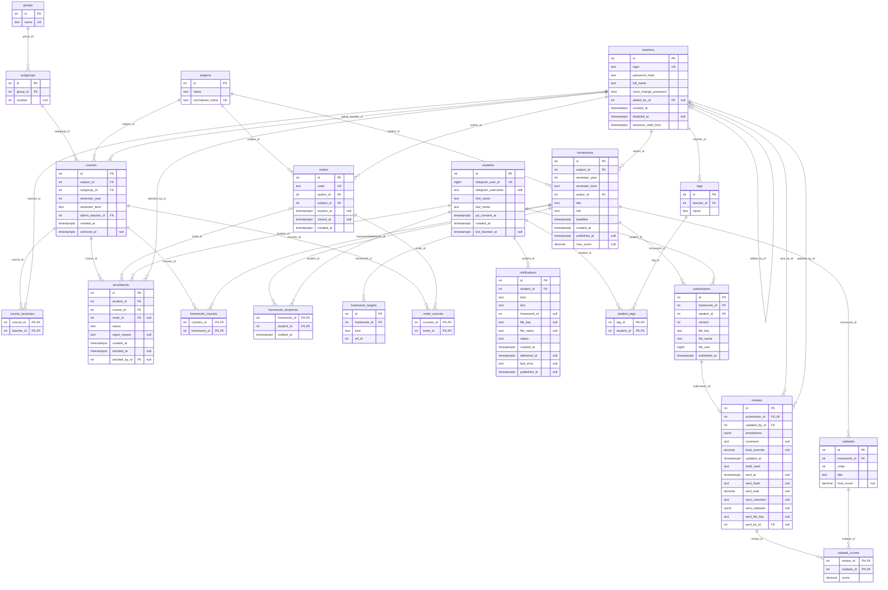

# Схема БД

PostgreSQL, схема задаётся миграциями EF Core (`src/Fiit.Api/Data/Migrations`). Имена — snake_case от сущностей `src/Fiit.Api/Domain`. Диаграмма ниже сгенерирована из живой схемы; после новой миграции её пересобирают:

```bash
docker compose run --rm migrate migrate   # локальная БД на последней миграции
python3 scripts/db-diagram.py             # перезаписывает блок диаграммы в этом файле
```

## Таблицы

| Область | Таблицы |
|---|---|
| Преподаватели и доступ | `teachers` — аккаунты (`added_by_id` — кто завёл, `sessions_valid_from` — отзыв JWT); `course_accesses` — кому из коллег открыт курс; `tags` + `student_tags` — личные метки преподавателя на студентах |
| Курсы | `subjects` — справочник предметов; `groups` + `subgroups` — ФТ-201 и её подгруппы; `courses` — предмет × подгруппа × семестр, `admin_teacher_id` — ведущий |
| Набор студентов | `invites` + `invite_courses` — ссылки-приглашения на один или несколько курсов; `students` — анкета из бота (`telegram_user_id`); `enrollments` — заявка студента в курс: Pending / Approved / Rejected, кто и когда решил |
| Задания | `homeworks` — ДЗ (черновик, пока `published_at` пуст; `max_score` — если нет подзадач с баллами); `homework_courses` — в каких курсах; `homework_targets` — сужение адресатов: `kind` (Course / Tag / Student) + `ref_id` (ссылка без FK, тип зависит от `kind`); пусто — все студенты курсов; `homework_recipients` — кому фактически разослано при публикации; `subtasks` — подзадачи с баллами |
| Сдача и проверка | `submissions` — версии работы студента (файл в S3 по `file_key`); `reviews` — проверка версии: черновик (`annotations`, `comment`, `total_override`, `draft_hash`) и отправленное (`sent_*`, `sent_file_key` — PDF с пометками); `subtask_scores` — баллы по подзадачам в черновике |
| Уведомления | `notifications` — outbox сообщений студенту: Pending → Published (в RabbitMQ) → Delivered / Failed |

**Уникальность, которой нет на диаграмме** (составные и частичные индексы):

- `courses (subject_id, subgroup_id, semester_year, semester_term)` — один курс на подгруппу в семестре;
- `enrollments (student_id, course_id) where status in (Pending, Approved)` — одна живая заявка; отклонённых может быть сколько угодно, можно подать снова;
- `submissions (homework_id, student_id, version)` — номер версии; при гонке двух сдач API повторяет с новым номером;
- `subgroups (group_id, number)`, `tags (teacher_id, name)`, `subtask_scores (review_id, subtask_id)`, `homework_recipients (homework_id, student_id)`, а также пары в связующих таблицах `course_accesses`, `homework_courses`, `invite_courses`, `student_tags`;
- `notifications (id) where status = 'Pending'` — частичный индекс для публикатора outbox (не уникальный).

**Связи без FK:** `homework_targets.ref_id` (см. выше), `notifications.homework_id` (для кнопки «Сдать» в боте).

**Чего в схеме нет намеренно:** опоздание не хранится (`submitted_at > deadline` по текущему дедлайну), итог сводной не хранится (сумма по отправленным проверкам), файлы лежат в S3, в БД только ключи.

## Диаграмма

`PK` — первичный ключ, `FK` — внешний, `UK` — уникальный, `"null"` — может быть пустым. Связь `|o` — необязательная ссылка, `o|` — не больше одной записи.

<!-- db-diagram:begin -->

<!-- db-diagram:end -->
